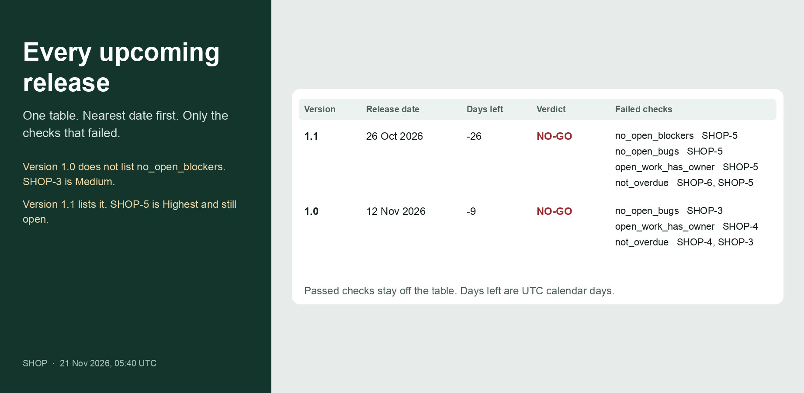
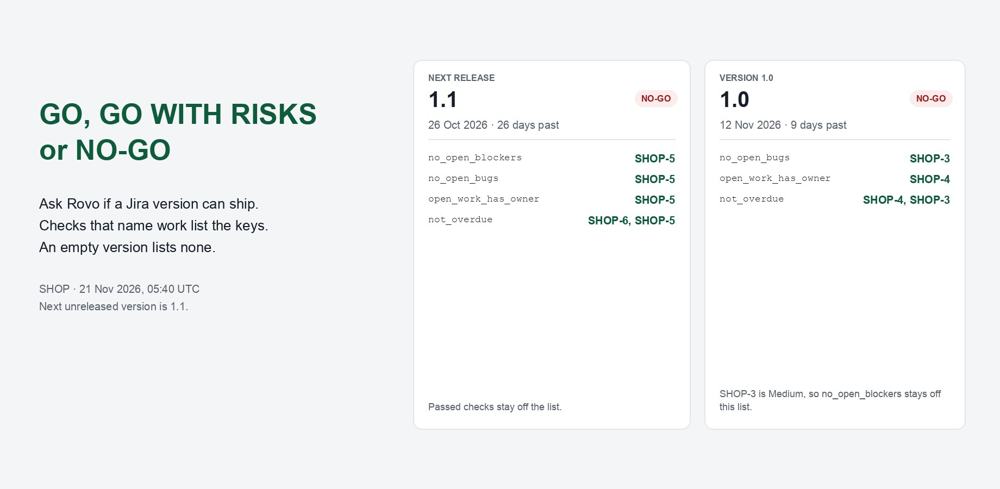
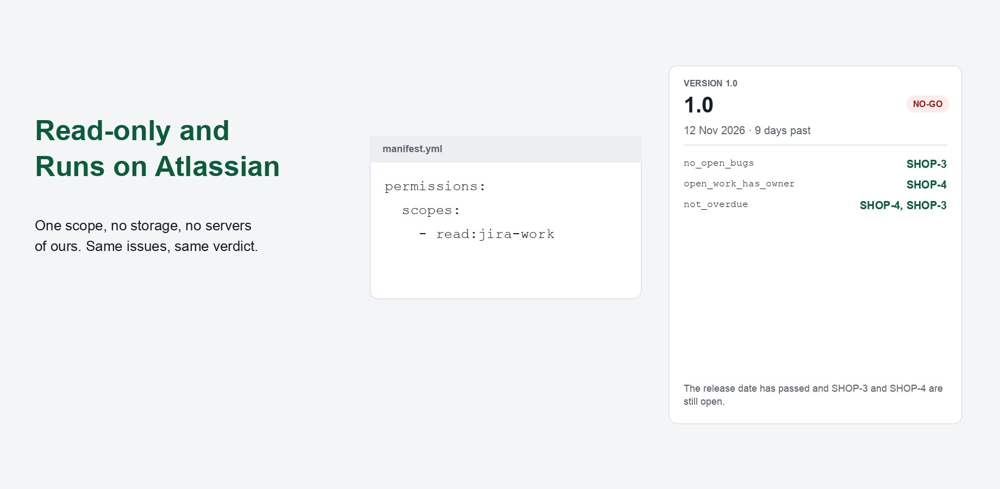

# Release Gate for Jira

A Rovo agent that answers one question for a team about to ship: **can this release go live?**

The agent never counts issues itself. The `check-release` action reads the version and its issues
from Jira and runs fixed rules; the model only explains the result and suggests the smallest next step.
Same issue keys in, same verdict out.

**On the Atlassian Marketplace** (free, approved November 13, 2026):
https://marketplace.atlassian.com/apps/2098465123/release-gate-for-jira

## First result in Jira

You need a Jira Cloud site with Rovo available, permission to read the project, and a version
with issues assigned through **Fix versions**. Installation requires an administrator.

1. Open the [Marketplace listing](https://marketplace.atlassian.com/apps/2098465123/release-gate-for-jira),
   choose **Get it now**, and select your Jira site. If already installed, continue in Jira.
2. Open the project, choose **Ask Rovo**, then open the agent selector next to **Rovo**.
   Search for **Release Gate** and select it. Asking the default Rovo agent is not the same step.
3. Send `Check release readiness for project SHOP, version 1.0. Show the verdict, failed checks and issue keys.`
   Replace `SHOP` and `1.0` with your project key and exact version name.
4. Read the verdict. A failed check that names work lists the issue keys. An empty version
   and a missing release date fail with no keys. A passed date fails only while work is open.
   Open the named issues, address the underlying work in Jira, then ask again. Release Gate
   reads data; it does not change issues, move release dates, or release a version for you.

No terminal, API token, seed script, or Forge registration is needed to use the installed app.
The development instructions further down are for people building the app.

## Worked example: why the same demo now says NO-GO

On **November 18, 2026**, we ran the prompt above in our QA Jira site with the installed
Release Gate agent. This is a real QA result, not a customer testimonial or a promise that
your project will return the same verdict.

| Input or result | Observed value |
|---|---|
| Project / version | `SHOP` / `1.0` |
| Verdict | **NO-GO** |
| Open / done | **2 / 2** |
| Release date | **November 12, 2026**, confirmed in Jira |
| No open bugs | Failed: `SHOP-3`, Shipping quote rounds cents wrong for PR |
| Open work has owner | Failed: `SHOP-4`, Write release notes for 1.0 |
| Not overdue | Failed: `SHOP-4`, `SHOP-3` |

The older video below shows **GO WITH RISKS** for 1.0. The release date has since passed
while those two issues remain open, so the overdue rule now makes it **NO-GO**. A changing
verdict is expected when dates or Jira data change; the video is a dated demonstration.

On November 19, we found why these values differed: the Forge source still rounded the remaining hours to the end of the release date, while the public guide repository had already switched to UTC calendar days. The deployable source now uses UTC date boundaries. For this same QA input, the action returns **-6** on November 18; a release due today is **0**, and becomes overdue on the next UTC date. Focused regression tests cover these boundaries. This corrects the deterministic action result; a post-deploy Rovo interaction remains unverified.

### Same issues on 20 November 2026

The live SHOP 1.0 issues were read again from Jira on 20 November 2026 and passed through `releaseFacts`, the function the deployed `check-release` action uses to decide the verdict. Nothing in the version had changed: release date 12 November 2026, SHOP-1 and SHOP-2 done, SHOP-3 an open bug, SHOP-4 an open task with no assignee.

| Input or result | Observed value |
|---|---|
| Project / version | `SHOP` / `1.0` |
| Verdict | **NO-GO** |
| Days left | **-8** |
| Open / done | **2 / 2** |
| No open bugs | Failed: `SHOP-3`, Shipping quote rounds cents wrong for PR |
| Open work has owner | Failed: `SHOP-4`, Write release notes for 1.0 |
| Not overdue | Failed: `SHOP-4`, `SHOP-3` |

18 November was -6 for this release date. 20 November is -8. The function counts UTC calendar dates, so two later dates are two days further overdue. A release due on the day of the check is still 0. This run called the function with that Jira payload. A new Rovo chat was not opened.

The useful next steps are to resolve the bug and assign the release-notes task. The team
also needs to finish the remaining work or agree on a realistic new release date in Jira.
Assigning the task alone does not clear the bug or the overdue check. Merely moving the
date does not complete the work. Ask again after the actual changes; this example does
not claim those fixes were performed.

### A passed date after the work is finished

The table above is NO-GO because SHOP-3 and SHOP-4 are still open. The date by itself does not keep that verdict. The same release date and the same check time, with all four issues Done and each carrying a resolution, is what `releaseFacts` returns:

| Input or result | Observed value |
|---|---|
| Project / version | `SHOP` / `1.0` |
| Release date | **November 12, 2026** |
| Check time | **20 November 2026, 05:47 UTC** |
| Days left | **-8** |
| Open / done | **0 / 4** |
| Verdict | **GO** |
| Not overdue | Passed. No issue key is listed. |

An empty version with that same date is **GO WITH RISKS**. The empty-version check fails and lists no keys. A missing release date fails the same way. Only the checks that point at work name issue keys. This run called the function. A new Rovo chat was not opened.

### Every upcoming release on 21 November 2026

The public listing highlight "Every upcoming release in one table" shows the SHOP overview measured at 21 November 2026, 05:40 UTC. Nearest release date first. Only the checks that failed are on the table.



| Version | Release date | Days left | Verdict | Failed checks |
|---|---|---|---|---|
| 1.1 | 26 October 2026 | -26 | NO-GO | `no_open_blockers` SHOP-5; `no_open_bugs` SHOP-5; `open_work_has_owner` SHOP-5; `not_overdue` SHOP-6, SHOP-5 |
| 1.0 | 12 November 2026 | -9 | NO-GO | `no_open_bugs` SHOP-3; `open_work_has_owner` SHOP-4; `not_overdue` SHOP-4, SHOP-3 |

Version 1.0 omits `no_open_blockers` because SHOP-3 is Medium. Version 1.1 lists it because SHOP-5 is Highest and still open. Passed checks stay off the table. Days left are UTC calendar days.

This called `releasesOverview` with the live Jira payload, in source commit `9134e0d`. A new Rovo chat was not opened. Production received that build on 21 November 2026 at 01:48 (Forge job `64cfed92056f`). The public listing version is still 2.0.0.

[Install Release Gate free and check your own version](https://marketplace.atlassian.com/apps/2098465123/release-gate-for-jira).

### Highlights 1 and 3 on 21 November 2026

The public highlights "Checks that name work list the keys" and "Read-only and Runs on Atlassian" show this same SHOP run. The pictures are the function output at 21 November 2026, 05:40 UTC. A new Rovo chat was not opened.

Next unreleased version is 1.1. Release date 26 October 2026, 26 days past, verdict NO-GO. Failed checks: `no_open_blockers` SHOP-5; `no_open_bugs` SHOP-5; `open_work_has_owner` SHOP-5; `not_overdue` SHOP-6, SHOP-5.

Version 1.0, release date 12 November 2026, 9 days past, verdict NO-GO. Failed checks: `no_open_bugs` SHOP-3; `open_work_has_owner` SHOP-4; `not_overdue` SHOP-4, SHOP-3. SHOP-3 is Medium, so `no_open_blockers` stays off that list.

The third highlight places the manifest scope `read:jira-work` beside the 1.0 card. The same issues produce the same verdict.





The listing files are `ff9d007a-0916-4fbf-9877-18763899222d` and `cba52d37-7766-4f7a-8384-e17dbcdb6718`. Highlight 2 stays `e4b93ec8-84bc-4e84-b5f5-4b91a899a5ea`. The older video further down still shows GO WITH RISKS for 1.0. Those frames are from before the release date passed.

[Install Release Gate free and check your own version](https://marketplace.atlassian.com/apps/2098465123/release-gate-for-jira).

### A High bug is not listed as a blocker

High is not Highest, Blocker or Critical, so `no_open_blockers` stays off `failed` for a High bug. The 1.1 row above is the live case: SHOP-5 is Highest. The input below is a separate function example.

`releaseFacts` returns `failed` with only the checks that are not ok. The Rovo prompt copies that list. When `issues` is empty, it says no issue key and does not invent one.

Input passed to the function: version `1.0`, release date 12 November 2026, check time 20 November 2026 05:47 UTC, one unfinished Bug `SHOP-3` at priority High, with an assignee.

| Field | Value |
|---|---|
| Verdict | **NO-GO** |
| Days left | **-8** |
| `failed` | `no_open_bugs`, issues `SHOP-3`. `not_overdue`, issues `SHOP-3`. |
| `no_open_blockers` | Not in `failed`. |

An empty version `9.0` with release date 1 December 2026, checked 10 November 2026 12:00 UTC, is **GO WITH RISKS**. `failed` is only `has_issues`, and `issues` is `[]`. `no_open_blockers` is not listed.

This called the function in source commit `9134e0d`. A new Rovo chat was not opened. The production environment that a Marketplace install runs received this build on 21 November 2026 at 01:48 (Forge job `64cfed92056f`). The public listing version is still 2.0.0. The public highlight is the 21 November overview above.

### If your first check does not match

- **Agent missing:** confirm the app is installed on the same Jira site and that Rovo is available;
  ask the site administrator to check access. Do not register a new Forge app.
- **No project key:** there is no verdict. See
  [When the question has no project key](#when-the-question-has-no-project-key).
  A blank key is the same sentence. A key in any letter case is not.
- **Project not found or no permission:** these are different sentences. See
  [When Jira refuses the project](#when-jira-refuses-the-project). A 404 asks you to check the key.
  A 401 or 403 does not.
- **Version not found:** the sentence lists the names Jira returned. See
  [When the version name is not in the project](#when-the-version-name-is-not-in-the-project).
  With no name, the app chooses the next unreleased,
  non-archived version by release date; name the version explicitly when comparing results.
- **Zero issues:** check the issues' **Fix versions** field. An empty version is **GO WITH RISKS**,
  not a verified green release. That check lists no issue keys.
- **The date has passed and the verdict is GO:** every issue in the version is done. The overdue
  check fails only while work is open. Days left can stay negative on a GO.
- **An overview omits your version, or the answer says the read stopped:** see
  [When the read stops at 1000 issues](#when-the-read-stops-at-1000-issues).
  The overview stops at ten unreleased versions. One version stops at 1000 issues.
  Those are two different sentences.

**GO** means the listed checks passed for the data read. It is not a deployment approval,
security review, or guarantee that all work is complete: owned, non-blocking open tasks can
still pass these checks.

| Check | Rule | Effect |
|---|---|---|
| `no_open_blockers` | No unfinished Highest/Blocker/Critical issue | NO-GO |
| `not_overdue` | Release date not passed while work is open | NO-GO |
| `no_open_bugs` | No unfinished Bug | risk |
| `open_work_has_owner` | Every unfinished issue has an assignee | risk |
| `done_has_resolution` | Done issues carry a resolution | risk |
| `has_issues` | The version has at least one issue | risk |
| `has_release_date` | The version has a release date | risk |

Runs on Atlassian: no external egress, no storage outside Jira, read-only scopes.

## When the question has no project key

[Install Release Gate for Jira](https://marketplace.atlassian.com/apps/2098465123/release-gate-for-jira).
Both checks need a project key before they read Jira. With no key, there is no verdict and no issue list.

**Input:** you ask whether a release can go live and you do not name a project key. A blank key, or a key that is not text, is the same input.

**Result:** `Ask the user for the Jira project key.`

That sentence is the whole answer. One version and every upcoming release return it. Name the key, such as `SHOP`, and ask again. A key in any letter case is read as uppercase, so `shop` is `SHOP` and is not this sentence. When the call sends no `projectKey` and the Jira context already has one, that context key is used. A blank `projectKey` is not replaced by the context.

The production checks are `checkRelease` and `checkAllReleases` in source `9134e0d`. They return before any Jira read. This was not a new Rovo chat.

## When Jira refuses the project

[Install Release Gate for Jira](https://marketplace.atlassian.com/apps/2098465123/release-gate-for-jira).
The check reads versions with your Jira permission. A refused read does not show Jira's JSON.
It shows one of the sentences below. A wrong key and a missing permission are not the same next step.

**Input:** the project key you asked about, and the HTTP status Jira returned for that read.

| Status | What you see | What to do |
|---|---|---|
| 404 | Jira project "ZZZ" was not found, or you cannot see it. Check the project key. | Use the key, such as `SHOP`, not the project name. |
| 401 or 403 | You have no permission to read project "ZZZ" in Jira. | The key can be right. You need permission to read that project's issues. Another key does not fix this. |
| Any other status, for example 500 | Jira returned an error (500). Try again in a moment. | Wait and ask again. This is not a wrong key and not a missing permission. |

Replace `ZZZ` with the key you sent. The number in the third sentence is the status Jira returned.

**Input:** the project exists, you do not name a version, and every version is released or archived.
**Result:** `SHOP has no unreleased version.` Name a version when you want a released one checked.

On 22 November 2026 a read of versions for the key `NOSUCH` returned HTTP 404. A read of versions for `SHOP` returned HTTP 200, so that key is not the 404 sentence. A 401 and a 403 were not produced on that site. Those two statuses are the second sentence in the production check (`jiraErrorMessage`, source `9134e0d`). This was not a new Rovo chat.

## When the version name is not in the project

[Install Release Gate for Jira](https://marketplace.atlassian.com/apps/2098465123/release-gate-for-jira).
If you name a version and that name is not in the project, the check does not show Jira's JSON.
It shows one sentence, and that sentence lists the version names Jira returned.

**Input:** project key `SHOP`, version name `9.9`.

**Result:** `Version "9.9" not found in SHOP. Known: 1.0, 1.1`

The name in quotes is the name you sent. The key is the project key in uppercase. The list after `Known:` is every version name Jira returned for that project, in that order. A released or archived name is included when Jira returns it. Letter case does not matter: `1.0` is found and this sentence is not shown.

On 22 November 2026 a read of versions for `SHOP` returned two names, both unreleased: `1.0` (release date 2026-11-12) and `1.1` (release date 2026-10-26). Asking for `9.9` is the sentence above. The production check is `findVersion` in source `9134e0d`. This was not a new Rovo chat.

## When the read stops at 1000 issues

[Install Release Gate for Jira](https://marketplace.atlassian.com/apps/2098465123/release-gate-for-jira).
One version check reads at most 1000 issues. When the search still has another page, the answer adds one note. The number in that note is `1000`, with no comma.

**Input:** a version whose issue search still has a next page after 1000 issues.

**Result:** `Only the first 1000 issues of a version were read: counts and the verdict may be incomplete.`

The verdict and the counts use only those issues. Issues on the next page are not in the counts. Do not treat that verdict as a complete release audit.

An overview of unreleased versions uses the same note when any checked version stops at 1000 issues. A project with more than ten unreleased versions gets a different sentence, and that sentence names both numbers.

**Input:** 11 unreleased versions, and you do not name one.

**Result:** `Only 10 of 11 unreleased versions were checked; summary totals cover these versions only. Ask for a specific version name to check an omitted release.`

The first number is how many were checked, at most 10. The second is how many unreleased, non-archived versions the project has. Name the version you want. Ten or fewer unreleased versions do not add this sentence.

The production checks are `versionIssues` and `checkAllReleases` in source `9134e0d`. This was not a new Rovo chat.

## Development only

```bash
npm install
npm test                 # rules, no Jira needed
forge register && forge deploy && forge install --product jira
```

Then open Rovo in Jira and ask "Can our next release go live?", or "Which of our upcoming releases are ready?"
for one table with every unreleased version (nearest release date first), its verdict and the failed checks
(`check-all-releases`, first 10 versions by date).

The verified user path above uses Rovo. The project-page source in this public repository is
not a guarantee that a sidebar page is available in your installed version.

Demo data (the seed script creates two versions; the video recorded one GO WITH RISKS and one NO-GO; current QA numbers are in the worked example above):

```bash
JIRA_SITE=https://<site>.atlassian.net JIRA_EMAIL=<you> JIRA_TOKEN=<api token> node scripts/seed-demo.mjs SCRUM
```

The video used a free Atlassian developer site (`dms-release-gate.atlassian.net`, project `SHOP`)
seeded with this script. Its recorded verdicts depend on the dates and data at recording time;
see the newer worked example above.


## Demo video

https://youtu.be/gc8xQk8Q1Jc (2:23): Rovo answers GO WITH RISKS for version 1.0 and NO-GO for 1.1 on the demo site,
with the real Jira data and the test run.

## For judges

1. Open the [installation link](https://developer.atlassian.com/console/install/4f921b30-1b0e-4951-b96c-4312c4d7e0d0?signature=AYABeOXYXqcMrUncna%2FLOFp41aMAAAADAAdhd3Mta21zAEthcm46YXdzOmttczp1cy13ZXN0LTI6NzA5NTg3ODM1MjQzOmtleS83MDVlZDY3MC1mNTdjLTQxYjUtOWY5Yi1lM2YyZGNjMTQ2ZTcAuAECAQB4CxqLTo9l4lqXuFjNim1xJM%2Bp%2F3TVP9xHS2BrU5DRRucBlRoW%2Fl5Oxo2XF4%2FDwJgwPAAAAH4wfAYJKoZIhvcNAQcGoG8wbQIBADBoBgkqhkiG9w0BBwEwHgYJYIZIAWUDBAEuMBEEDGc4J62UDNdvDlsj9AIBEIA79KK3RbgNo5YQRUnbM%2FtLGZr8IkKaLNOk11Q8kDzAaAnspgmG7hqq%2FNvbQVJhXtYVFFfKjZ8BmLjSsx8AB2F3cy1rbXMAS2Fybjphd3M6a21zOmV1LXdlc3QtMTo3MDk1ODc4MzUyNDM6a2V5LzQ2MzBjZTZiLTAwYzMtNGRlMi04NzdiLTYyN2UyMDYwZTVjYwC4AQICAHi9bVMAkme4qVQX1fQHo6ePw3H40A7cGfz7yrmSfBWMXgF3UJgC%2BkDpGjvBI%2ByPnLLQAAAAfjB8BgkqhkiG9w0BBwagbzBtAgEAMGgGCSqGSIb3DQEHATAeBglghkgBZQMEAS4wEQQM3RrzgYVXCd1bTevFAgEQgDs304SnJtx1Jt%2FFEPJSr97FGyCLcX3IZu8xmjaaFrP%2F3v%2FI1NTkq2CE1pY95XRlEri5whiAFbAhTlWLogAHYXdzLWttcwBLYXJuOmF3czprbXM6dXMtZWFzdC0xOjcwOTU4NzgzNTI0MzprZXkvNmMxMjBiYTAtNGNkNS00OTg1LWI4MmUtNDBhMDQ5NTJjYzU3ALgBAgIAeDYASx0XCjkny4iLV6vz%2BKtEGSGT6kdt0QRpkn6D%2FlVEAVuhq9BnCrlF%2F5GpMzTeIVQAAAB%2BMHwGCSqGSIb3DQEHBqBvMG0CAQAwaAYJKoZIhvcNAQcBMB4GCWCGSAFlAwQBLjARBAydyNH45KW6V8dT67sCARCAOxIFthHAfY4%2B%2F103tef6F%2B2tScj42nFQNZUY%2BWGC62fgGRRqDqMrVwkL1wKgL%2B7t6PX46iuIFa%2FufXv4AgAAAAAMAAAQAAAAAAAAAAAAAAAAAFTi2iacCr4WkiJ8dx%2FMs77%2F%2F%2F%2F%2FAAAAAQAAAAAAAAAAAAAAAQAAADJD4Dco6VKyq1xkH36esB8Ws%2BFVMs3%2BnwRlMas%2Bi5r5%2ByKeWgmZb8RktkFklhHKbH%2Bz62aHugcArZ1gdX5v%2BmFEcF4%3D&product=jira) and install Release Gate on a Jira Cloud site with Rovo enabled.
2. Seed demo data in any project (or use your own versions):
   `JIRA_SITE=https://<site>.atlassian.net JIRA_EMAIL=<you> JIRA_TOKEN=<api token> node scripts/seed-demo.mjs <PROJECT KEY>`
3. In Jira, open Ask Rovo, change the agent to **Release Gate** and ask "What is blocking version 1.0?" or
   "Can our next release go live?". On the QA project, compare the verdict and the issue keys with the
   worked example above. The video's GO WITH RISKS for 1.0 is the result from before that release date
   passed. "Which of our upcoming releases are ready?" lists the unreleased versions in one table with the totals.

No configuration, no external accounts: the app only reads Jira (`read:jira-work`).

Built by Design Master Solutions LLC for Codegeist 2026. MIT.
